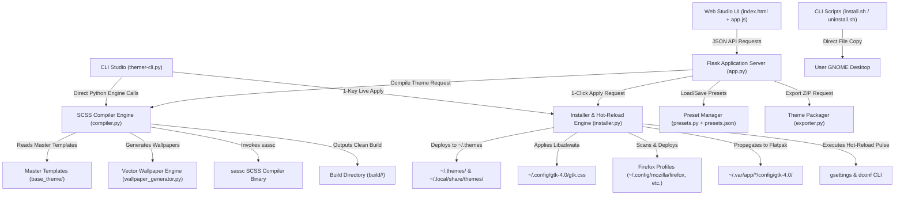

# 🤖 AGENTS.md — AI Agent & Developer Architecture Guide

This document is the official technical specification, architecture contract, and contribution guide for **AI Coding Agents** (Antigravity, Claude Code, Cursor, Copilot Workspace, Devin, Aider, etc.) and human developers extending **GNOME Theme Studio (`gnome-theme-studio`)**.

---

## 🎯 1. Project Philosophy & Identity

**GNOME Theme Studio** is an all-in-one Linux desktop personalization suite. Its goal is **extreme visual polish, mathematical color harmony, and total consistency** across all components of the Linux desktop:
* **GNOME Shell (45–51+)**
* **GTK 4 / Libadwaita**
* **GTK 3**
* **Mozilla Firefox / LibreWolf / Waterfox**
* **Sandboxed Flatpak apps**
* **Vector 4K Desktop Wallpapers**

The project provides three usage modes that must always remain in perfect parity:
1. **Visual Studio Mode (Web GUI)**: Real-time interactive mockup, live CSS editing, color pickers, metric sliders, compilation logs, and 1-click live hot-reload (`app.py`, `templates/index.html`, `static/js/app.js`).
2. **Interactive CLI Studio Mode (`themer-cli.py`)**: Zero-dependency single-screen dual-panel terminal interface (*htop / kconfig* style) with preset navigation, live spacebar toggling of scheme, GNOME accents, macOS traffic lights, and 1-key live hot-reload (`A` / `Enter`). Also supports headless automation flags (`--apply`, `--list`, `--export`, `--reset`).
3. **Direct CLI Mode**: Fully automated bash installer and uninstaller (`install.sh`, `uninstall.sh`) that works out-of-the-box in headless or terminal environments.

---

## 🏗️ 2. Architectural Blueprint

The codebase is organized into modular layers:



---

## 📁 3. Source File Catalog & Responsibilities

| File Path | Primary Responsibility | Key Functions / Elements |
| :--- | :--- | :--- |
| [`app.py`](app.py) | Flask HTTP server and REST API endpoints. | `/api/system-status`, `/api/presets`, `/api/compile`, `/api/apply`, `/api/export`, `/api/reset-defaults`. |
| [`compiler.py`](compiler.py) | SCSS compiler, dynamic variable injection, asset processing. | `generate_scss_variables()`, `process_svg_assets()`, `generate_index_theme()`, `compile_theme()`. |
| [`installer.py`](installer.py) | System interaction engine: gsettings, dconf, profiles, hot-reload pulse. | `get_current_theme_status()`, `get_firefox_profile_dirs()`, `install_firefox_theme()`, `install_and_apply_theme()`, `reset_gnome_defaults()`. |
| [`presets.py`](presets.py) | JSON preset loading, validation, saving, and deletion. | `load_presets()`, `save_preset()`, `delete_preset()`. |
| [`presets.json`](presets.json) | Database of 22 calibrated color palettes. | Everforest, Catppuccin, Nord, Tokyo Night, Dracula, Gruvbox, etc. |
| [`wallpaper_generator.py`](wallpaper_generator.py) | Generates mathematical 4K vector SVG wallpapers matching palette. | `generate_svg_wallpaper(config, style)`: `abstract_waves`, `aurora`, `geometric`. |
| [`exporter.py`](exporter.py) | Compiles and packages themes into portable `.zip` archives with embedded installer. | `create_theme_zip(theme_name, compiled_dir)`. |
| [`themer-cli.py`](themer-cli.py) | Standalone interactive CLI Studio (dual-panel single-screen) & batch script tool. | Single-screen TUI (`run_single_screen_studio`), Spacebar toggles/cycles, TrueColor swatches, CLI flags (`--preset`, `--apply`, `--list`, `--status`, `--reset`, `--export`). |
| [`base_theme/`](base_theme/) | Immutable master SCSS templates. | Subdirectories: `gnome-shell/`, `gtk-3.0/`, `gtk-4.0/`, `firefox/`, `scss/`. |
| [`install.sh`](install.sh) | Standalone bash installer for command-line users. | CLI options: `--install`, `--uninstall`, `--status`. |
| [`uninstall.sh`](uninstall.sh) | Restores factory GNOME desktop defaults. | Resets GTK, Shell, color-scheme, accent-color, cleans Flatpak & Firefox. |
| [`templates/index.html`](templates/index.html) | Single-page Theme Studio web interface. | Tailwind CSS, interactive mockup, color pickers, log console. |
| [`static/js/app.js`](static/js/app.js) | Frontend client controller. | Reactive state, live preview updating, API fetch orchestration. |

---

## ⚠️ 4. Critical Theming Invariants (Rules That Must Never Be Broken)

When modifying or extending this codebase, any agent or developer **must preserve these exact invariants**:

### 🛡️ Invariant 1: Libadwaita / Nautilus ToolbarView Zero-Desfase Architecture
Modern GNOME applications (Nautilus, Settings, Text Editor, System Monitor) utilize `AdwApplicationWindow` containing `AdwToolbarView` or `AdwOverlaySplitView`.
* **THE BUG TO PREVENT:** If `background-color` is applied directly to `headerbar`, a **6-pixel vertical gap / misalignment** appears above the titlebar because `headerbar` is an internal child of `.top-bar`, exposing the window's background (`@window_bg_color`).
* **THE MANDATORY RULE:**
  1. The outer container `toolbarview > .top-bar` must have `background-color: @headerbar_bg_color;`.
  2. The internal headerbars must remain transparent:
     ```scss
     toolbarview > .top-bar headerbar,
     toolbarview > .bottom-bar headerbar,
     headerbar.flat {
       background: none !important;
       background-color: transparent !important;
       box-shadow: none !important;
     }
     ```
  3. The sidebar top-bar must seamlessly match the sidebar background:
     ```scss
     .sidebar-pane toolbarview > .top-bar,
     navigation-split-view > .sidebar-pane toolbarview > .top-bar,
     overlay-split-view > .sidebar-pane toolbarview > .top-bar {
       background-color: @sidebar_bg_color !important;
       color: @sidebar_fg_color;
     }
     ```
  4. Maximized and fullscreen windows must reset border radius:
     ```scss
     window.maximized, window.fullscreen {
       border-radius: 0 !important;
       box-shadow: none !important;
     }
     ```

### 🛡️ Invariant 2: Multi-Path Firefox Profile Scanning
* Never assume Firefox profiles live only in `~/.mozilla/firefox/`.
* On modern Linux distributions (Fedora, Arch, modern Debian/Ubuntu), Firefox adheres to the **XDG Base Directory Specification** and stores profiles in `~/.config/mozilla/firefox/`.
* In addition, Flatpak applications use `~/.var/app/org.mozilla.firefox/.mozilla/firefox/`, and Snap uses `~/snap/firefox/common/.mozilla/firefox/`.
* **Rule:** Always scan all known paths in `get_firefox_profile_dirs()`. Always inspect `profiles.ini` and verify directories containing `prefs.js` or `default`.
* **Rule:** In `user.js`, always ensure:
  ```javascript
  user_pref("toolkit.legacyUserProfileCustomizations.stylesheets", true);
  user_pref("browser.tabs.drawInTitlebar", true);
  user_pref("browser.theme.toolbar-theme", 0);
  user_pref("browser.theme.content-theme", 0);
  user_pref("svg.context-properties.content.enabled", true);
  ```

### 🛡️ Invariant 3: GTK 3 Base Inheritance Switching
* `base_theme/gtk-3.0/gtk.scss` must **never** hardcode `gtk-contained-dark.css`.
* `compiler.py` must dynamically select:
  - If `color_scheme == "light"`: `resource:///org/gtk/libgtk/theme/Adwaita/gtk-contained.css`
  - If `color_scheme == "dark"`: `resource:///org/gtk/libgtk/theme/Adwaita/gtk-contained-dark.css`
* Hardcoding dark Adwaita causes light GTK3 applications to render dark widgets, dark checkbuttons, and inverted borders.

### 🛡️ Invariant 4: Live Hot-Reload Trick on Wayland
* GNOME Shell running on Wayland does not allow restarting the shell process (`Alt + F2 -> r` is disabled on Wayland).
* To trigger an instant live CSS reload without logging out, `installer.py` and `install.sh` use the **dconf pulse trick**:
  1. Write empty string to `/org/gnome/shell/extensions/user-theme/name`.
  2. Sleep 150ms.
  3. Write the actual theme name back to `/org/gnome/shell/extensions/user-theme/name`.
  4. Toggle GTK theme to `Adwaita` for 100ms and back to trigger GTK's live stylesheet watcher.

### 🛡️ Invariant 5: Clean Build Workspace Isolation
* Compilation must occur in a dedicated temporary workspace: `build/.tmp_<theme_name>_<timestamp>`.
* Raw `.scss` files and intermediate `scss/` folders must be deleted before moving the output to `build/<theme_name>`.
* The final build directory must only contain clean, production `.css` and asset files.

---

## 🔌 5. REST API Specifications

The Flask server (`app.py`) exposes the following endpoints:

### `GET /api/system-status`
Returns the active desktop configuration.
**Response:**
```json
{
  "success": true,
  "status": {
    "gtk_theme": "Everforest-Dark",
    "color_scheme": "prefer-dark",
    "accent_color": "green",
    "shell_theme": "Everforest-Dark",
    "user_theme_extension": "ACTIVE",
    "gtk4_config_active": true,
    "button_layout": "appmenu:minimize,maximize,close"
  }
}
```

### `GET /api/presets`
Returns all available theme presets from `presets.json`.

### `POST /api/compile`
Compiles SCSS stylesheets into `build/<theme_name>` without applying them to the system.
**Request Payload:**
```json
{
  "theme_name": "Custom-Theme",
  "color_scheme": "dark",
  "accent_color": "#a7c080",
  "accent_fg": "#1a201c",
  "accent_secondary": "#83c092",
  "window_bg": "#2d353b",
  "sidebar_bg": "#272e33",
  "surface_elevated": "#343f44",
  "headerbar_bg": "#232a2e",
  "text_primary": "#d3c6aa",
  "text_muted": "#859289",
  "border_color": "#3d484d",
  "border_active": "#475258",
  "destructive_color": "#e67e80",
  "warning_color": "#dbbc7f",
  "window_radius": 12,
  "button_radius": 8,
  "border_width": 1,
  "panel_opacity": 1.0,
  "popup_radius": 20,
  "quick_settings_radius": 36,
  "window_controls_style": "traffic-hover",
  "window_controls_size": 14,
  "button_layout": "right",
  "wallpaper_style": "abstract_waves"
}
```
**Response:**
```json
{
  "success": true,
  "theme_name": "Custom-Theme",
  "output_dir": "/path/to/build/Custom-Theme",
  "duration_ms": 342.5,
  "logs": ["..."]
}
```

### `POST /api/apply`
1-Click workflow: Compiles the theme, installs to `~/.themes`, applies GTK4 to `~/.config/gtk-4.0/`, generates vector wallpaper, themes Firefox profiles, and triggers the live hot-reload pulse.
**Request Payload:**
```json
{
  "config": { ... },
  "apply_gtk4": true,
  "apply_wallpaper": true,
  "apply_firefox": true
}
```

### `POST /api/export`
Compiles the theme, packages it with an embedded standalone installer, and returns a binary downloadable `.zip` stream.

### `POST /api/reset-defaults`
Restores GNOME Desktop, GTK theme (`Adwaita`), color-scheme, accent-color, wallpapers, and cleans custom GTK4 and Firefox styles.

---

## 🛠️ 6. Verification & Development Workflows

### How to test Python syntax:
```bash
python3 -m py_compile app.py compiler.py installer.py presets.py exporter.py wallpaper_generator.py themer-cli.py
```

### How to test CLI Studio and Flags:
```bash
./themer-cli.py --list
./themer-cli.py --status
```

### How to test theme compilation from Python without applying:
```bash
python3 -c "
import compiler, presets
data = presets.load_presets()
config = data['Everforest Dark']
res = compiler.compile_theme(config)
assert res['success'] == True
print('Compiled successfully in', res['duration_ms'], 'ms')
for log in res['logs']:
    print(' ', log)
"
```

### How to test Light theme compilation and GTK3 contained stylesheet switching:
```bash
python3 -c "
import compiler, presets
data = presets.load_presets()
config = data['Everforest Light']
res = compiler.compile_theme(config)
assert res['success'] == True
with open(res['output_dir'] + '/gtk-3.0/gtk.css') as f:
    content = f.read()
    assert 'gtk-contained.css' in content and 'gtk-contained-dark.css' not in content
print('Light theme GTK3 switching verified successfully!')
"
```

### Parity Rule for Repository Precompiled Artifacts:
Whenever any file inside `base_theme/` is modified, you **must** recompile the flagship Everforest Dark theme and copy the resulting CSS files into the root directories:
* `build/Everforest-Dark/gtk-4.0/*` $\rightarrow$ `gtk-4.0/`
* `build/Everforest-Dark/gtk-3.0/*` $\rightarrow$ `gtk-3.0/`
* `build/Everforest-Dark/gnome-shell/*` $\rightarrow$ `gnome-shell/`
* `build/Everforest-Dark/firefox/*` $\rightarrow$ `firefox/`

This ensures `./install.sh` run directly by terminal users always matches the latest master templates without needing `python3 app.py` running.

---

## 🚀 7. Checklist for Future Pull Requests / Agent Tasks

Before concluding any task on this codebase, verify that:
1. `sassc` compilation succeeds for all 6 targets: GTK 4, GTK 3, GNOME Shell, Pad OSD, Firefox userChrome, Firefox userContent.
2. Nautilus split-view headerbars have zero gap and match the sidebar seamlessly.
3. Firefox profiles across XDG, legacy, Flatpak, and Snap are discovered and themed.
4. Python files pass `py_compile` without warnings or syntax errors.
5. `README.md` and `AGENTS.md` reflect any new capabilities added.
