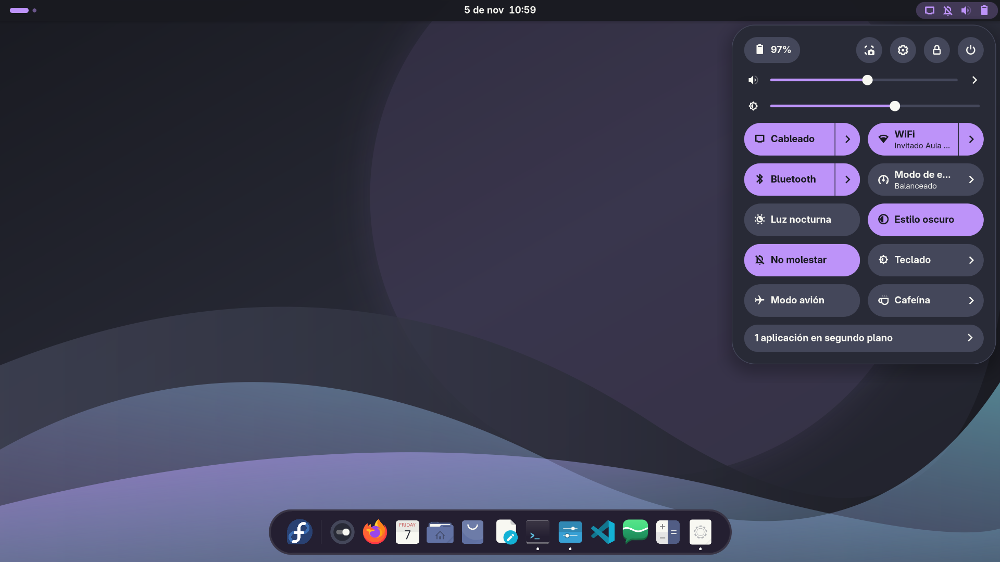
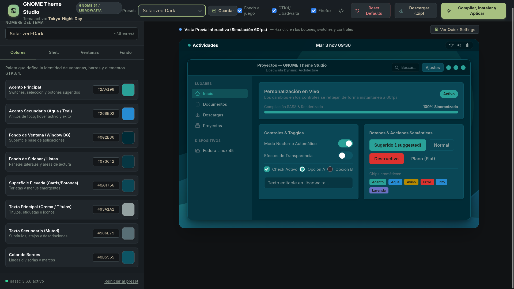
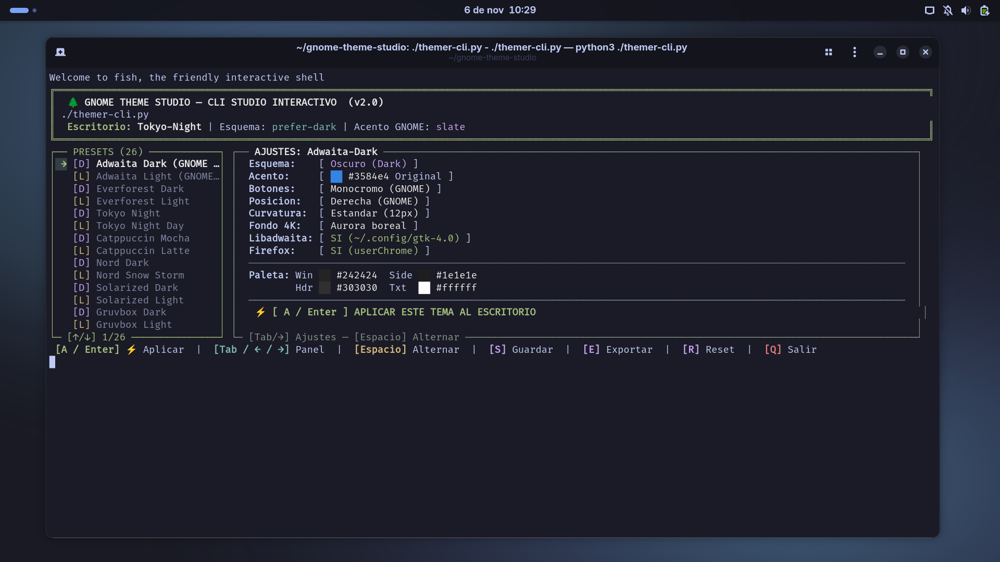
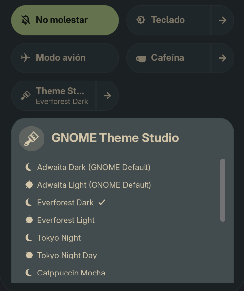
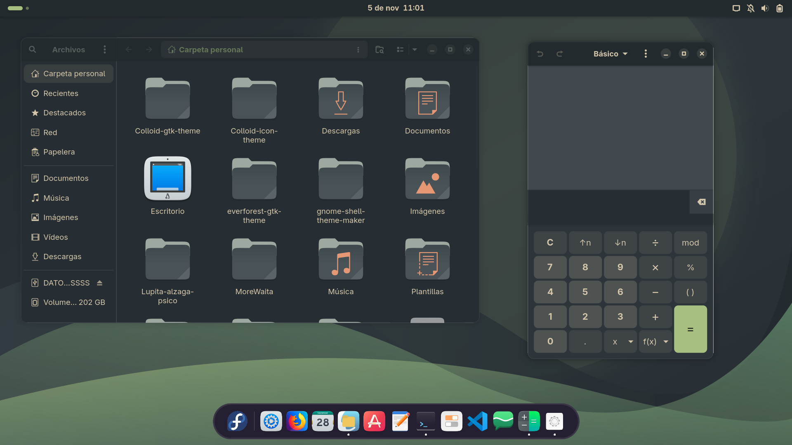
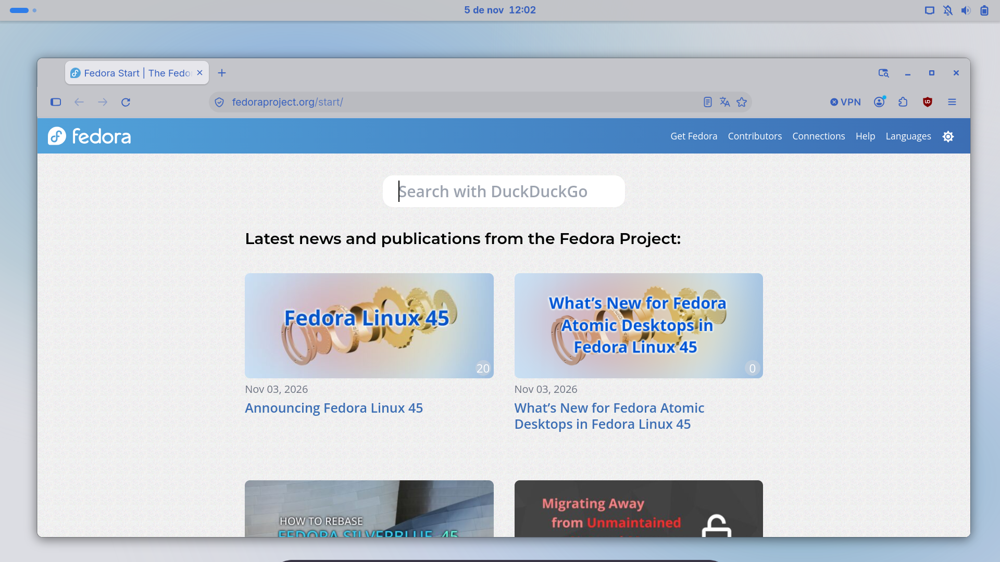

# 🌲 GNOME Theme Studio

[](https://www.gnome.org/)
[](https://gitlab.gnome.org/GNOME/gnome-shell)
[](gnome-extension/)
[-green?logo=gtk)](https://www.gtk.org/)
[](https://www.mozilla.org/firefox/)
[](https://python.org)
[](LICENSE)

**GNOME Theme Studio** es una suite profesional, visual y completa para crear, personalizar, compilar y aplicar temas extremadamente pulidos y unificados para el entorno de escritorio **Linux GNOME Desktop**.

Tematiza de forma sincronizada y con consistencia milimétrica:
* **Extensión nativa de GNOME Shell** integrada en Quick Settings con ventana de preferencias Libadwaita para personalizar tus 5 presets favoritos y aplicarlos en 1-clic.
* **GNOME Shell** (45, 46, 47, 51+)
* **GTK 4 / Libadwaita** (Nautilus, Ajustes, Monitor del Sistema, Visor de Textos, etc.)
* **GTK 3** (GIMP, Inkscape, Nemo, pavucontrol, gestores de archivos clásicos)
* **Mozilla Firefox**, LibreWolf y Waterfox (mediante `userChrome.css` y `userContent.css`)
* **Aplicaciones Flatpak** sandboxed
* **Fondos de pantalla vectoriales 4K a juego** generados algorítmicamente.

---

## 📸 Capturas de Pantalla (Showcase)

<!-- Coloca tus capturas en la carpeta screenshots/ con los nombres: desktop.png, studio.png, cli.png, extension.png, nautilus.png y firefox.png -->

<p align="center">
  
  <br>
  <em>Escritorio GNOME completo con tema aplicado, panel superior, aplicaciones Libadwaita y fondo de pantalla vectorial 4K a juego.</em>
</p>

<table align="center" width="100%">
  <tr>
    <td width="50%" align="center">
      <br>
      <b>Estudio Visual Web (<code>http://localhost:5000</code>)</b><br>
      <sub>Mockup interactivo en tiempo real con selectores de color, métricas y recarga en caliente.</sub>
    </td>
    <td width="50%" align="center">
      <br>
      <b>Studio Interactivo CLI (<code>./themer-cli.py</code>)</b><br>
      <sub>Panel unificado en terminal: navega presets, altera esquemas, acentos y botones con la barra espaciadora.</sub>
    </td>
  </tr>
</table>

<table align="center" width="100%">
  <tr>
    <td width="50%" align="center">
      <br>
      <b>Extensión Quick Settings & Preferencias (<code>gnome-extension/</code>)</b><br>
      <sub>Menú nativo en el panel superior con 5 presets favoritos personalizables desde el Gestor de Extensiones y aplicación en 1 clic.</sub>
    </td>
    <td width="50%" align="center">
      <br>
      <b>Libadwaita / Nautilus (Zero-Desfase)</b><br>
      <sub>Headerbar continuo de borde a borde y barra lateral perfectamente alineada sin franjas residuales.</sub>
    </td>
  </tr>
</table>

<table align="center" width="100%">
  <tr>
    <td width="100%" align="center">
      <br>
      <b>Mozilla Firefox + userChrome</b><br>
      <sub>Pestañas nativas integradas y botones de ventana con semáforo hover interactivo.</sub>
    </td>
  </tr>
</table>

> 💡 **Nota para capturas**: Consulta la [Guía de Capturas de Pantalla](screenshots/README.md) para conocer las resoluciones y nombres recomendados al subir tus imágenes a GitHub.

---

## ✨ Características Destacadas (Key Features)

### 🎨 1. Estudio Visual en Tiempo Real (Web UI)
Interfaz web moderna con visualizador interactivo (Mockup) que refleja en vivo cada cambio de color, radio de curvatura y grosor de bordes antes de compilar o aplicar al sistema.

### 💻 2. Studio Interactivo en Terminal CLI (themer-cli.py)
Entorno interactivo TUI en pantalla única (estilo *htop / kconfig*) sin dependencias externas:
* **Panel dual sincronizado**: Explora la biblioteca de presets en el panel izquierdo mientras ves su configuración y paleta en el panel derecho.
* **Alternancia instantánea con la barra espaciadora (`Espacio`)**: Modifica esquemas (*Dark / Light*), colores de acento oficiales de GNOME, controles de ventana (*macOS traffic-lights / GNOME*), curvaturas y fondos de pantalla 4K al vuelo sin entrar en submenús.
* **1-Tecla / 1-Clic (`A` / `Enter`)**: Compila y aplica directamente el tema con recarga en caliente Wayland.
* **Automatización por flags**: Compatible con ejecución desatendida mediante `--list`, `--preset`, `--apply`, `--export`, `--status` y `--reset`.

### 🧩 3. Extensión Nativa Quick Settings para GNOME Shell (45–51+)
Integración oficial y fluida con el menú de ajustes rápidos (*Quick Settings*) de GNOME:
* **Acceso Inmediato desde el Panel Superior**: Botón nativo de GNOME con icono de paleta (`preferences-desktop-theme-symbolic`) que refleja en tiempo real el tema activo en su subtítulo.
* **5 Presets Favoritos Personalizables**: Elige exactamente qué 5 temas aparecen en el menú para un acceso ultra rápido y un escritorio limpio.
* **Ventana de Preferencias Nativa (`prefs.js` / Libadwaita)**: Modifica tus 5 presets favoritos, activa el modo compacto o personaliza accesos directos desde el **Gestor de Extensiones** (`gnome-extensions-app`).
* **Menú con Soporte para Catálogo Completo**: Alterna entre ver únicamente los 5 favoritos o explorar los más de 20 temas calibrados con desplazamiento suave (*scroll* adaptativo).
* **Aplicación 1-Clic Asíncrona (Non-Blocking)**: Compila y aplica GTK4, GTK3, GNOME Shell, Firefox y fondos 4K en segundo plano mediante `Gio.Subprocess`, manteniendo el compositor de GNOME a 60/120+ FPS sin congelar la pantalla.
* **Sincronización Reactiva Bidireccional**: Detecta cambios realizados desde la Web UI o la terminal (`themer-cli.py`) a través de `Gio.Settings` (`changed::gtk-theme`) y actualiza su subtítulo y marca de verificación (`✓`) al instante.
* **Acciones Rápidas Integradas**: Atajos de 1-clic para abrir el Web Studio (`http://localhost:5000`), restablecer el escritorio a Adwaita de fábrica o abrir la configuración de la extensión.

### 📐 4. Arquitectura de Título y Barra Superior de Nautilus (Zero-Desfase)
En Libadwaita moderna (`AdwToolbarView`), muchas implementaciones de temas provocan un desfase o franja de 6 píxeles sobre la barra de título de Nautilus (donde el fondo de la ventana se filtra). GNOME Theme Studio implementa una estructura CSS de alta precisión:
* El contenedor superior (`toolbarview > .top-bar`) absorbe uniformemente el color de la barra desde el píxel 0.
* Los `headerbar` interiores se mantienen 100% transparentes, eliminando solapamientos o sombras duplicadas.
* La barra superior del panel lateral (`.sidebar-pane`) adopta de extremo a extremo el color del sidebar (`@sidebar_bg_color`), asegurando una continuidad estética perfecta entre panel y contenido.
* Ventanas maximizadas o a pantalla completa eliminan limpiamente los bordes redondeados (`border-radius: 0 !important`).

### 🦊 5. Integración Nativa con Mozilla Firefox
A diferencia de otros temas donde el navegador queda aislado del resto del escritorio:
* Detecta automáticamente perfiles activos en rutas **XDG modernas** (`~/.config/mozilla/firefox/`), rutas clásicas (`~/.mozilla/firefox/`), **Flatpak** y **Snap**, así como LibreWolf y Waterfox.
* Compila dinámicamente `userChrome.css` y `userContent.css` con los colores exactos de la paleta.
* Configura de forma transparente `user.js` con `toolkit.legacyUserProfileCustomizations.stylesheets = true` y dibujado en barra de título.
* **Controles de ventana precisos**: El contenedor exterior permanece 100% transparente y el semáforo hover (`traffic-hover`) ilumina únicamente el botón que recibe el foco, sin desbordamientos de color.

### ⚡ 6. Compilador Multi-Destino Basado en SCSS (`sassc`)
Compila hojas de estilo completas en menos de 300 milisegundos:
* Inyección dinámica de variables y métricas.
* Sustitución inteligente de color primario y secundario en iconos SVG (`gnome-shell-start.svg`, calendarios, workspaces).
* Conmutación automática en GTK 3: hereda de `gtk-contained.css` si el tema es claro, o `gtk-contained-dark.css` si es oscuro.

### 🔁 7. Aplicador y Recarga en Caliente en 1-Clic (Hot-Reload)
* Aplica el tema sin reiniciar la sesión en entornos **Wayland** y **X11** mediante un pulso coordinado a través de `gsettings` y `dconf`.
* Sincroniza el color de acento oficial del sistema (`accent-color` de GNOME 47+) con el tono más cercano de la paleta.

### 🖼️ 8. Generador de Fondos de Pantalla Vectoriales 4K
Genera y aplica fondos SVG matemáticos (3840×2160) en estilos:
* **Abstract Waves** (Ondas orgánicas fluidas estilo GNOME)
* **Aurora** (Gradientes radiales atmosféricos de alto contraste)
* **Geometric** (Polígonos modernos facetados con transparencias sutiles)

### 📦 9. Exportador de Temas Portables (.ZIP)
Genera paquetes `.zip` listos para distribuir con un script instalador autónomo (`install.sh`) para que cualquier usuario de Linux pueda instalar tu creación con un solo comando.

---

## 🗂️ Biblioteca de Presets Incluidos (22 Paletas Calibradas)

| Preset | Variante | Acento Primario | Fondo de Ventana |
| :--- | :---: | :---: | :---: |
| **Everforest Dark** *(Flagship)* | Oscuro | `#a7c080` (Forest Green) | `#2d353b` |
| **Everforest Light** | Claro | `#8da101` (Soft Olive) | `#fdf6e3` |
| **Catppuccin Mocha** | Oscuro | `#cba6f7` (Mauve) | `#1e1e2e` |
| **Catppuccin Latte** | Claro | `#8839ef` (Mauve) | `#eff1f5` |
| **Tokyo Night** | Oscuro | `#7aa2f7` (Neon Blue) | `#1a1b26` |
| **Tokyo Night Day** | Claro | `#34548a` (Deep Blue) | `#e1e2e7` |
| **Nord Dark** | Oscuro | `#88c0d0` (Frost Cyan) | `#2e3440` |
| **Nord Snow Storm** | Claro | `#5e81ac` (Deep Frost) | `#eceff4` |
| **Gruvbox Dark** | Oscuro | `#b8bb26` (Bright Green) | `#282828` |
| **Gruvbox Light** | Claro | `#79740e` (Dark Green) | `#fbf1c7` |
| **Dracula** | Oscuro | `#bd93f9` (Purple) | `#282a36` |
| **Rosé Pine** | Oscuro | `#ebbcba` (Rose) | `#191724` |
| **Rosé Pine Dawn** | Claro | `#d7827e` (Rose Dawn) | `#faf4ed` |
| **Cyberpunk 2077** | Oscuro | `#00f0ff` (Cyan Neon) | `#12131a` |
| **One Dark Pro** | Oscuro | `#61afef` (Atom Blue) | `#282c34` |
| **One Light** | Claro | `#4078f2` (Atom Blue) | `#fafafa` |
| **Kanagawa Wave** | Oscuro | `#98bb6c` (Spring Green) | `#1f1f28` |
| **Monokai Pro** | Oscuro | `#ffd866` (Sun Yellow) | `#2d2a2e` |
| **Adwaita Dark** | Oscuro | `#3584e4` (GNOME Blue) | `#242424` |
| **Adwaita Light** | Claro | `#3584e4` (GNOME Blue) | `#fafafa` |
| **Solarized Dark** | Oscuro | `#268bd2` (Solar Blue) | `#002b36` |
| **Solarized Light** | Claro | `#268bd2` (Solar Blue) | `#fdf6e3` |

---

## 📋 Requisitos del Sistema (Prerequisites)

Para ejecutar GNOME Theme Studio o compilar temas en tu equipo necesitas:

### 1. Dependencias del Sistema
* **Entorno de escritorio GNOME** (GNOME Shell 45, 46, 47, 51+)
* **`sassc`**: Compilador binario de SCSS (imprescindible para el Theme Studio).
* **`python3`** (3.10 o superior) y módulo `python3-venv`.
* **Extensión `user-theme`**: Requerida por GNOME para permitir temas de terceros en el Shell (`user-theme@gnome-shell-extensions.gcampax.github.com`).

#### Comando de instalación según tu distribución:

**Fedora / RHEL / CentOS:**
```bash
sudo dnf install -y sassc python3 python3-pip gnome-shell-extension-user-theme
```

**Ubuntu / Debian / Linux Mint:**
```bash
sudo apt update
sudo apt install -y sassc python3 python3-venv python3-pip gnome-shell-extension-prefs gnome-shell-extensions
```

**Arch Linux / Manjaro:**
```bash
sudo pacman -S --needed sassc python gnome-shell-extensions
```

---

## 🚀 Guía de Inicio Rápido (Quick Start)

Puedes utilizar el proyecto en cuatro modalidades según tu preferencia: mediante el **Estudio Visual Web interactivo**, mediante el **Selector y Personalizador CLI interactivo en terminal (`themer-cli.py`)**, mediante el **Instalador de Terminal CLI directo (`install.sh`)**, o directamente desde el panel superior con la **Extensión nativa de GNOME Quick Settings (`gnome-extension/`)**.

### Método A: Estudio Visual Web

1. Inicia el servidor de Theme Studio:
   ```bash
   ./start.sh
   ```

2. Se abrirá automáticamente tu navegador en `http://localhost:5000`:
   - Selecciona cualquiera de los **26 presets** o crea tu paleta personalizada.
   - Ajusta colores de fondo, acento, cabeceras, superficies y texto.
   - Modifica métricas en vivo: radio de ventana, radio de botones y estilo de controles.
   - Elige el estilo de fondo de pantalla vectorial 4K.
   - Haz clic en **"Compilar, Instalar y Aplicar"** para ver tu escritorio transformarse al instante.

---

### Método B: Selector y Personalizador CLI en Terminal (`themer-cli.py`)

Si prefieres la terminal pero quieres poder elegir cualquier preset de la biblioteca, personalizar sus apartados y aplicarlo con previsualizaciones de color en tiempo real (sin necesidad de navegador ni servidor web):

```bash
./themer-cli.py
```

> 💎 **Potenciado por Rich**: Diseñado con bordes redondeados (`box.ROUNDED`), cuadrícula responsiva, spinners animados de compilación y auto-detección del entorno virtual `venv/`.

#### Características del Studio CLI (Interfaz Unificada en Tarjeta):
* **Navegación ultra-simple y sin divisiones**:
  - `↑` / `↓`: Desplaza el cursor selector `➜` a través de todas las opciones.
  - `←` / `→` o `Espacio` o `Enter`: Cambia o alterna el valor de la opción activa de forma cíclica `[ ◀  Valor  ▶ ]`.
* **Ajustes interactivos disponibles**:
  - **Tema Preset**: Cambia entre los 26 presets disponibles con un solo toque.
  - **Esquema**: Alterna al instante entre modo `Oscuro (Dark)` y `Claro (Light)` vinculando las variantes oficiales del preset.
  - **Color de Acento**: Rota por la paleta oficial de acentos GNOME (Azul, Teal, Verde, Amarillo, Naranja, Rojo, etc.) con muestra de color RGB real en terminal.
  - **Botones Ventana**: Rota entre `Semáforo macOS (hover)`, `Semáforo fijo`, `Monocromo GNOME` y `Minimalista`.
  - **Posición Botones**: Alterna entre `Derecha (GNOME)` e `Izquierda (macOS)`.
  - **Curvatura Ventana**: Rota entre `Estándar (12px)`, `Moderno (16px)`, `Muy Redondo (22px)` y `Cuadrado (4px)`.
  - **Fondo 4K Vectorial**: Rota entre `Ondas fluidas (Waves)`, `Aurora boreal`, `Geométrico` y `Ninguno`.
  - **Libadwaita / Firefox**: Activa o desactiva con un toque.
* **Aplicación inmediata en 1-Tecla**:
  - Presiona `Enter` sobre la fila `⚡ APLICAR TEMA`, o pulsa `A` en cualquier momento desde cualquier opción para compilar y aplicar el tema al escritorio con recarga en caliente Wayland.
* **Atajos de teclado**: `A` (Aplicar), `S` (Guardar preset), `E` (Exportar ZIP), `R` (Restablecer GNOME) y `Q` / `Esc` (Salir).

#### Modo de comandos directos (sin interfaz interactiva):
```bash
# Listar todos los presets con swatches de color
./themer-cli.py --list

# Aplicar un preset directamente
./themer-cli.py --preset "Tokyo Night" --apply

# Aplicar con personalizaciones directas por parámetro
./themer-cli.py --preset "Catppuccin Mocha" --wallpaper-style aurora --layout left --apply

# Exportar un preset a paquete .ZIP con instalador autónomo
./themer-cli.py --preset "Nord Dark" --export

# Ver el estado del entorno de escritorio GNOME
./themer-cli.py --status

# Restablecer GNOME a la apariencia predeterminada de fábrica
./themer-cli.py --reset
```

---

### Método C: Instalador CLI Directo Autónomo (Terminal)

Si deseas aplicar de inmediato la versión precompilada del tema insigne (**Everforest Dark**) sin dependencias ni preguntas:

```bash
./install.sh
```

El script ejecutará automáticamente:
1. Copia de temas en `~/.themes/Everforest-Dark` y `~/.local/share/themes/Everforest-Dark`.
2. Configuración de **GTK 4 / Libadwaita** en `~/.config/gtk-4.0/gtk.css`.
3. Integración con **Mozilla Firefox** en todos los perfiles de usuario detectados.
4. Concesión de permisos a aplicaciones **Flatpak**.
5. Activación de la extensión `user-theme` y fijación del tema en `gsettings` y `dconf`.
6. Pulso de recarga en caliente para refrescar la interfaz sin cerrar sesión.

#### Comandos adicionales del instalador CLI:
```bash
# Ver el estado actual de tu entorno GNOME
./install.sh --status

# Desinstalar y volver a la configuración estándar Adwaita
./install.sh --uninstall
```

---

### Método D: Extensión GNOME Quick Settings (`gnome-extension/`)

Si deseas cambiar de tema y preset en cualquier momento directamente desde el panel superior de GNOME sin abrir la terminal ni el navegador web:

1. **Instala la extensión en tu sistema:**
   ```bash
   ./gnome-extension/install.sh
   ```
   *El instalador compila los esquemas GSettings, enlaza automáticamente la extensión en `~/.local/share/gnome-shell/extensions/theme-studio@angelaguayo.github.io` y la habilita.*

2. **Activa la extensión por primera vez:**
   * **En Wayland**: GNOME Shell no recarga extensiones nuevas en caliente; simplemente **cierra tu sesión de usuario y vuelve a iniciarla**.
   * **En X11**: Presiona `Alt + F2`, escribe `r` y presiona `Enter`.

3. **Uso desde Quick Settings:**
   * Haz clic en el menú del sistema (esquina superior derecha de tu pantalla).
   * Verás el nuevo botón interactivo **«Theme Studio»** mostrando el tema actualmente activo en su subtítulo.
   * Haz clic en la flecha o cuerpo del botón para ver los **5 presets favoritos** con aplicación en 1 clic.
   * Al seleccionar cualquier tema, la extensión compilará y aplicará el tema en segundo plano de forma asíncrona (sin congelar la pantalla) y ejecutará la recarga en caliente Wayland.
   * Disfruta de accesos directos al pie del menú para **Abrir Web Studio (`localhost:5000`)**, **Restablecer escritorio (Adwaita)** o **Configuración de la extensión...**.

4. **Personalizar los 5 Presets desde el Gestor de Extensiones:**
   * Abre la aplicación **Extensiones** (o *Gestor de Extensiones* / `gnome-extensions-app`).
   * Haz clic en el botón de engranaje **⚙** al lado de «GNOME Theme Studio» (o pulsa *«Configuración de la extensión...»* desde el menú de Quick Settings, o corre `gnome-extensions prefs theme-studio@angelaguayo.github.io`).
   * En la ventana de preferencias:
     - **Selecciona tus 5 temas preferidos**: Usa los desplegables (*Opción 1 a 5*) para elegir exactamente qué paletas deseas tener en el panel superior (Everforest, Catppuccin, Tokyo Night, Nord, Gruvbox, etc.).
     - **Modo Compacto**: Alterna el interruptor *«Mostrar únicamente los 5 favoritos»* para mantener el menú ultra ligero o mostrar el catálogo completo de más de 20 temas.
     - **Accesos y Notificaciones**: Activa o desactiva botones auxiliares y notificaciones de escritorio al aplicar temas.
   * *Tip para usuarios de terminal (automatización mediante `gsettings`):*
     ```bash
     # Cambiar el preset favorito 1 a Tokyo Night
     gsettings set org.gnome.shell.extensions.theme-studio favorite-preset-1 "Tokyo Night"

     # Activar modo compacto (solo los 5 favoritos)
     gsettings set org.gnome.shell.extensions.theme-studio show-only-favorites true
     ```

5. **Sincronización Total y Detección de Entorno:**
   * Si cambias de tema mediante `themer-cli.py` o Web Studio, el indicador del panel superior se sincroniza automáticamente en tiempo real.
   * Los cambios que realices en el Gestor de Extensiones se reflejan al instante en el menú sin reiniciar el Shell.
   * La extensión detecta automáticamente el entorno virtual `venv/` del proyecto y resuelve las dependencias sin configuraciones manuales requeridas.

6. **Desinstalación o desactivación de la extensión:**
   ```bash
   gnome-extensions disable theme-studio@angelaguayo.github.io
   rm -rf ~/.local/share/gnome-shell/extensions/theme-studio@angelaguayo.github.io
   ```

---

## 🛠️ Estructura del Repositorio (Repository Structure)

```text
gnome-theme-studio/
├── README.md                      # Documentación completa para usuarios y desarrolladores
├── AGENTS.md                      # Especificaciones técnicas y contratos para Agentes AI
├── LICENSE                        # Licencia de código abierto MIT
├── .gitignore                     # Filtro de archivos compilados, temporales y venv
├── requirements.txt               # Dependencias Python (Flask)
├── start.sh                       # Lanzador del Theme Studio Web (gestiona venv y navegador)
├── themer-cli.py                  # Selector y personalizador CLI interactivo en terminal
├── install.sh                     # Instalador y configurador CLI autónomo
├── uninstall.sh                   # Restaurador a valores de fábrica de GNOME
├── gnome-extension/               # Extensión nativa de GNOME Shell 45–51+ para Quick Settings
│   ├── metadata.json              # Definición, UUID, settings-schema y versiones compatibles
│   ├── extension.js               # Implementación en GJS ESM con QuickMenuToggle y llamadas async
│   ├── prefs.js                   # Ventana de preferencias nativa Libadwaita (selección de 5 favoritos)
│   ├── stylesheet.css             # Estilos CSS de la extensión y límites de scroll
│   ├── install.sh                 # Script instalador, compilador de esquemas y habilitador
│   ├── schemas/                   # Definición de esquemas GSettings
│   │   ├── org.gnome.shell.extensions.theme-studio.gschema.xml
│   │   └── gschemas.compiled      # Esquema binario compilado
│   └── README.md                  # Documentación dedicada de la extensión
├── index.theme                    # Metadatos estándar FreeDesktop
├── app.py                         # Servidor Flask y API REST
├── compiler.py                    # Motor de inyección y compilación Sass/SCSS
├── installer.py                   # Motor del sistema: gsettings, dconf, Firefox y Flatpak
├── presets.py                     # Controlador de carga, guardado y borrado de presets
├── presets.json                   # Base de datos con las 22 paletas calibradas
├── wallpaper_generator.py         # Motor generador de fondos de pantalla vectoriales 4K SVG
├── exporter.py                    # Creador de paquetes ZIP distribuibles con instalador autónomo
├── base_theme/                    # Fuentes maestras SCSS inmutables
│   ├── scss/                      # Variables y métricas dinámicas
│   ├── gnome-shell/               # SCSS y assets SVG para GNOME Shell 51
│   ├── gtk-3.0/                   # SCSS y conmutador de base para GTK 3
│   ├── gtk-4.0/                   # SCSS con arquitectura Zero-Desfase para Libadwaita
│   └── firefox/                   # Plantillas maestras userChrome.scss y userContent.scss
├── screenshots/                   # Capturas de pantalla para el repositorio de GitHub
│   └── README.md                  # Guía de nombres y resoluciones para las capturas
├── templates/
│   └── index.html                 # Interfaz visual del Theme Studio con mockup interactivo
└── static/
    ├── css/                       # Estilos del Theme Studio
    └── js/
        └── app.js                 # Lógica interactiva del frontend, preview y peticiones API
```

---

## 🔧 Personalización Avanzada y Desarrollo (Hacking & Development)

### Añadir un nuevo Preset
Edita `presets.json` o guarda tu preset directamente desde la interfaz web haciendo clic en **"Guardar como nuevo preset"**. Cada preset contiene:
```json
{
  "theme_name": "Mi-Tema-Custom",
  "color_scheme": "dark",
  "accent_color": "#00f0ff",
  "accent_fg": "#101216",
  "accent_secondary": "#7000ff",
  "window_bg": "#12131a",
  "sidebar_bg": "#0c0d12",
  "surface_elevated": "#1b1d28",
  "headerbar_bg": "#08090d",
  "text_primary": "#f0f2f5",
  "text_muted": "#828799",
  "border_color": "#232636",
  "border_active": "#32374d",
  "destructive_color": "#ff0055",
  "warning_color": "#ffe600",
  "window_radius": 12,
  "button_radius": 8,
  "border_width": 1,
  "panel_opacity": 1.0,
  "popup_radius": 16,
  "quick_settings_radius": 32,
  "window_controls_style": "traffic-hover",
  "window_controls_size": 14,
  "button_layout": "right",
  "wallpaper_style": "abstract_waves"
}
```

### Probar compilación manual mediante Python:
```bash
python3 -c "
import compiler, presets
config = presets.load_presets()['Everforest Dark']
res = compiler.compile_theme(config)
print('Compilación exitosa:', res['success'], 'en', res['duration_ms'], 'ms')
"
```

---

## 🗑️ Restauración del Sistema (Uninstallation)

Si en cualquier momento deseas volver a la apariencia original y limpia de GNOME:
1. Desde la Web: Pulsa el botón **"Restablecer Predeterminados de GNOME"**.
2. Desde la Terminal: Ejecuta `./uninstall.sh`.
3. Desde la Extensión Quick Settings: Selecciona la opción **«Restablecer escritorio (Adwaita)»** directamente en el menú desplegable.

Esto restablecerá:
* Tema GTK a `Adwaita`
* Esquema de color y color de acento a los valores por defecto del sistema
* Tema de GNOME Shell al predeterminado del sistema
* Eliminación de estilos custom en `~/.config/gtk-4.0/gtk.css` y perfiles de Firefox
* Restauración del fondo de pantalla original de GNOME.

> ℹ️ **Extensión Quick Settings**: Si deseas deshabilitar o desinstalar la extensión, ejecuta:
> ```bash
> gnome-extensions disable theme-studio@angelaguayo.github.io
> rm -rf ~/.local/share/gnome-shell/extensions/theme-studio@angelaguayo.github.io
> ```

---

## 📄 Licencia y Créditos

* **Licencia:** Distribuido bajo la Licencia [MIT](LICENSE).
* **Créditos:** Diseñado para la comunidad GNOME, inspirado en el diseño limpio de Libadwaita y la elegancia cromática de paletas de código abierto como Everforest, Catppuccin, Nord y Tokyo Night.
